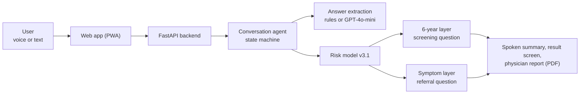

# Praevidio AI

> **Praevidio** (Latin, *I foresee*): a Turkish voice-driven assistant for lung cancer risk awareness and early referral.


Praevidio AI interviews a person in Turkish, by voice or text, about age, smoking, symptoms and other risk factors.
It answers two questions that are usually mixed up, *should I be screened?* and *should I see a doctor about my
symptoms?*, explains the answer in plain language and produces a report the person can take to a physician.

It is an awareness tool and not a diagnostic device: it never says "cancer" or "no cancer", and every result ends
with a concrete next step.

Senior project (CMPE 491/492), Department of Computer Engineering, Boğaziçi University, 2026.

## Why lung cancer, and why voice

- Lung cancer is the most common cancer and the leading cause of cancer death among men in Türkiye
  (age-standardised rate 68.0 per 100,000).
- More than half of the cases are diagnosed at stage 4, when treatment options are limited.
- 64.6 % of the population has inadequate health literacy; a spoken conversation is easier than a form.
- The risk factors and symptoms that matter (smoking dose, cough, breathlessness, coughing up blood) are things
  people can describe in their own words.

## What it does

| | |
| --- | --- |
| **Conversation** | A spoken or typed interview in Turkish. One open question about complaints, then only the symptoms that were not mentioned. Accepts "I don't know", repeats what it understood in the user's own words and takes corrections. |
| **Side questions** | The user can ask "what does pack-year mean?" or "why do you ask?" at any point; the agent explains and returns to its question. |
| **6-year risk** | Probability of a lung cancer diagnosis in the next six years from risk factors alone, on the PLCOm2012 model for ever-smokers and published incidence for never-smokers. Tied to the 1.5 % screening threshold. |
| **Symptom layer** | Probability that the present symptoms are due to lung cancer, compared with the 3 % referral threshold of NICE NG12, together with the NICE rule itself and a haemoptysis rule for any age. |
| **Plain-language result** | "About 42 in 10,000 people like you, against about 1.2 among peers without risk factors", and for smokers the risk at 50 if they continue and if they quit today. |
| **Screening eligibility** | USPSTF 2021 criteria for low-dose CT, independent of symptoms. |
| **Physician report** | PDF with the three scores and their thresholds, the reasons for an alert, the answers as given and ICD-10 codes. |
| **Runs on a phone** | Installable web app (PWA) with hands-free voice mode; the same interview also runs in a terminal. |

## How it works



The interview is a hand-written state machine, so the order of questions and every re-ask is explicit and
testable. The language model only turns sentences into structured answers; it never produces a risk or advice.
The risk comes from published models and a Bayesian network whose every number has a stated source.
Details: [`docs/architecture.md`](docs/architecture.md).

| Layer | Technology |
| --- | --- |
| Client | Progressive web app, plain HTML, CSS and JavaScript, service worker |
| Backend | Python 3.12, FastAPI, one agent thread per session |
| Speech | OpenAI `gpt-4o-mini-transcribe` (speech-to-text), `tts-1` voice "nova" (text-to-speech) |
| Answer extraction | Rule-based Turkish parser (offline) or GPT-4o-mini with guards |
| Risk model | PLCOm2012, Wakelee 2007, Bayesian network in `pgmpy` |
| Report | Jinja2 and WeasyPrint |
| Tests | pytest: model, API and recorded conversations |

## The risk model

| Layer | Question | Method | Threshold |
| --- | --- | --- | --- |
| 6-year layer | Should I be screened? | PLCOm2012 for ever-smokers, Wakelee 2007 incidence for never-smokers, normalised odds ratios for occupational exposure and air pollution | 1.5 % (PLCOm2012 screening threshold); 5 % for "high" |
| Symptom layer | Should I see a doctor about my symptoms? | Bayesian network with a latent *symptomatic now* state and with COPD and *other illness* as competing explanations of symptoms | 3 % (NICE NG12 referral threshold) |
| Prompt assessment | | NICE NG12 rule, or symptom layer at or above 3 %, or haemoptysis at any age | |

The model went through three versions, all still runnable with `load_engine("v2" | "v3.0" | "v3.1")`:

| Version | When | Change |
| --- | --- | --- |
| v2 | Spring 2026 | One network: NLST risk factors and literature symptom probabilities on a single cancer node |
| v3.0 | October 2026 | A review found four flaws; fixed with a latent symptomatic node, a COPD node, normalised odds ratios, a 6-year layer and the NICE rule |
| v3.1 | November 2026 | A user trial exposed a fifth flaw (85 % for a 45-year-old with five symptoms); fixed with the PLCOm2012 and Wakelee base and a common-cause node calibrated on NHANES, then a separate symptom layer |

Every score of every scenario under the three versions is in
[`docs/model_comparison_v2_v3.md`](docs/model_comparison_v2_v3.md); every parameter and its source is in
[`docs/model_parameters.md`](docs/model_parameters.md).

## Validation

- **174 automated tests** (`tests/model`, `tests/api`, `tests/conversations`), none of which call a paid API.
- **Clinical plausibility.** All 127 symptom combinations, on several base profiles, stay inside bounds derived
  from the positive predictive values of Hamilton et al. 2005; v3.0 broke them 270 times, v3.1 never does.
- **External references.** The 6-year layer is checked against PLCOm2012 and Wakelee 2007, the symptom
  frequencies and their association against NHANES 2007–12 (10,203 respondents aged 40 or more without cancer).
- **Regression.** The October model is frozen as a baseline of 43 profiles, so each later change is visible
  profile by profile ([`docs/model_v3_1_calibration_fix.md`](docs/model_v3_1_calibration_fix.md)).
- **Recorded conversations.** Real trial conversations, including two phone sessions, are replayed against the
  agent on every test run.
- **Risk-factor layer on NLST** (spring evaluation, hold-out of 16,036): AUC 0.65, calibration slope 1.00,
  expected calibration error 0.002. Accuracy and F1 are not reported, because the output is a risk and not a
  class.
- **In progress (December 2026).** Blind comparison with a chest physician on ten cases
  (`tests/expert_validation/`) and a usability study with the Turkish System Usability Scale
  (`tests/usability/`).

## Quick start

```bash
git clone https://github.com/SamedKizilhan/Praevidio-AI.git
cd Praevidio-AI
python3 -m venv .venv && source .venv/bin/activate
pip install -r requirements.txt
cp .env.example .env          # add OPENAI_API_KEY for voice and for llm mode

make api                      # backend and web app
# open http://localhost:8000/app/
```

Text mode with the rule-based parser needs no API key. Options are passed in the address:
`?nlp=llm` (GPT-4o-mini extraction), `?model=v2`, `?token=<PRAEVIDIO_API_TOKEN>`.

**On a phone.** The microphone needs HTTPS. Run `cloudflared tunnel --url http://localhost:8000`, open the printed
address with `/app/` appended and set `PRAEVIDIO_API_TOKEN` in `.env` while the server is exposed.

**In a terminal.**

```bash
make chat                     # typed interview
make voice                    # microphone and speaker (needs sox)
make chat NLP=keyword         # rule-based parser, offline
```

### Commands

| Command | Purpose |
| --- | --- |
| `make api` | Backend and web app at `localhost:8000` (`/docs` for the interactive API reference) |
| `make chat`, `make voice` | Interview in the terminal |
| `make model-test`, `make api-test`, `make conversation-test` | Test suites |
| `make replay F=<transcript>` | Replay a recorded conversation against the current agent |
| `make compare` | Regenerate the comparison of the three model versions |
| `make sensitivity`, `make v31-diff`, `make nhanes` | Regenerate the sensitivity, calibration-fix and NHANES reports |
| `make expert`, `make expert-analyze` | Expert form and answer key; comparison once answers are entered |
| `make sus` | Score the usability questionnaire |
| `make eval` | Discrimination, calibration and decision-curve metrics on NLST |
| `make scenarios`, `make calibrate`, `make explain` | Spring (v2) reports, kept in `docs/history/` |
| `make help` | Full list |

## Project structure

```
Praevidio-AI/
├── src/
│   ├── api/                  FastAPI backend: sessions, turns, audio, report, serves the web app
│   ├── web/                  Progressive web app (index.html, app.js, styles.css, service worker)
│   ├── conversation/         voice_agent.py (state machine), clarify.py (side questions),
│   │                         transcript.py and replay.py (recording and replaying conversations)
│   ├── nlp/                  symptom_extractor.py: Turkish answers to structured evidence
│   ├── stt/                  Speech-to-text wrapper
│   ├── model/
│   │   ├── hybrid_bayesian_network_v3.py   current risk model (v3.0 and v3.1)
│   │   ├── hybrid_bayesian_network.py      spring model (v2)
│   │   ├── plcom2012.py                    PLCOm2012 6-year risk
│   │   ├── screening.py                    USPSTF eligibility, pack-year parsing
│   │   ├── sensitivity_v3.py, nhanes_symptom_baselines.py, evaluation.py
│   │   └── explainability.py, calibrate_risk_factors.py, bayesian_network.py   (spring)
│   ├── report/               Physician report: generator and HTML template
│   ├── rag/, pipeline.py     ICD-10 retrieval with ChromaDB and the batch pipeline (spring)
│   └── config.py
├── tests/
│   ├── model/                Regression baseline, plausibility, context and symptom-layer tests
│   ├── api/                  End-to-end API tests and side-question tests
│   ├── conversations/        Recorded conversations replayed as regression tests
│   ├── test_scenarios/       21 scenarios and the three-version comparison
│   ├── expert_validation/    Ten cases, expert form, model answer key, analysis
│   └── usability/            SUS-TR protocol, questionnaire and scoring
├── docs/                     Design notes, parameters, generated reports (see below)
├── data/
│   ├── knowledge_base/       ICD-10 codes, provincial PM2.5 tiers
│   └── processed/            Cleaned NLST subset, NHANES results, evaluation outputs
├── tools/                    NHANES download, conversation replay, listening test
├── Makefile
└── requirements.txt
```

## Documentation

| Document | Content |
| --- | --- |
| [`docs/README.md`](docs/README.md) | Index of all documents |
| [`docs/architecture.md`](docs/architecture.md) | Components, a conversation turn, endpoints, design choices |
| [`docs/model_parameters.md`](docs/model_parameters.md) | Every parameter of the risk model, its source and its effect |
| [`docs/model_v3_design.md`](docs/model_v3_design.md) | Why v2 was revised: four findings and their fixes |
| [`docs/model_v3_1_calibration_fix.md`](docs/model_v3_1_calibration_fix.md) | The fifth finding: root causes, fixes, tests, change per profile |
| [`docs/symptom_layer.md`](docs/symptom_layer.md) | Why screening and referral are separate layers |
| [`docs/model_comparison_v2_v3.md`](docs/model_comparison_v2_v3.md) | All scenarios under v2, v3.0 and v3.1 |
| [`docs/sensitivity_v3.md`](docs/sensitivity_v3.md), [`docs/nhanes_symptom_baselines.md`](docs/nhanes_symptom_baselines.md) | Sensitivity analysis; calibration against NHANES |
| [`docs/dictionary.md`](docs/dictionary.md) | Glossary of clinical and modelling terms |
| [`docs/ProjectPlan_Fall2026.md`](docs/ProjectPlan_Fall2026.md) | Plan and status of the fall term |
| [`docs/history/`](docs/history/) | Archived documents of the spring model (v2) |

Documents are in English. Design notes that were first written in Turkish keep the Turkish text below the English
one, and material that is read by Turkish speakers (the expert form, the usability questionnaire, recorded
conversations) stays in Turkish with an English note at the top.

## Status

| Term | Delivered |
| --- | --- |
| Spring 2026 (CMPE 491) | Data preparation (NLST), the v2 Bayesian network, terminal voice agent, ICD-10 retrieval, PDF report, evaluation on NLST |
| Fall 2026 (CMPE 492) | Model review and v3.0, calibration fix v3.1, symptom layer, conversation flow with confirmations and side questions, FastAPI backend, PWA with voice mode, transcripts and replay tests, physician report with three scores |
| Remaining to 21 December 2026 | Expert validation session, usability study, map of the nearest cancer screening centres (KETEM), release v1.0.0 |

## Data sources and attribution

The source code is licensed under AGPL-3.0-or-later (see below). **Data files are not covered by the AGPL; they keep their original licences and terms.**

| Source | Used for | Licence / terms | Files in this repository |
| --- | --- | --- | --- |
| NLST public clinical subset (TCIA / NCI Imaging Data Commons, release 2021-05-27) | Base CPTs P(cancer \| age, sex, smoking); evaluation (AUC, calibration, DCA) | [CC BY 4.0](https://creativecommons.org/licenses/by/4.0/) + [TCIA Data Usage Policy](https://www.cancerimagingarchive.net/data-usage-policies-and-restrictions/) | `data/raw/nlst_780_*`, `data/raw/dictionary_idc_*`, `data/processed/nlst_cleaned.csv`, `data/processed/nlst_summary.json` |
| NHANES 2007–2012, RDQ/SMQ/MCQ/DEMO (CDC / NCHS) | Chronic cough and wheeze baselines and their association in people without cancer (v3 calibration) | U.S. public domain; citation requested | `data/processed/nhanes_symptom_baselines.json` (raw files are downloaded by `make nhanes-download`, not redistributed) |
| PLCOm2012 model (Tammemägi et al., 2013) | 6-year base risk for ever-smokers (v3.1) and external benchmark | Published coefficients; cite the paper | `src/model/plcom2012.py` |
| Peer-reviewed literature (Hamilton 2005, Beckles 2003, Kvale 2006, Hopwood & Stephens 2000, ILCCO, PLCOm2012, LLP …) | Symptom CPTs and risk-factor odds ratios | Cited facts | see `docs/model_parameters.md`, `docs/history/v2_symptom_cpt_derivation.md` |
| Wakelee et al., 2007 | 6-year base risk for never-smokers (v3.1) | Published incidence rates; cite the paper | `src/model/hybrid_bayesian_network_v3.py` |
| Hamilton et al., 2005 | Plausibility bounds on the effect of symptoms | Published predictive values; cite the paper | `tests/model/test_plausibility.py` |
| NICE guideline NG12 — *Suspected cancer: recognition and referral* | Prompt-assessment rule and the 3 % referral threshold of the symptom layer | NICE guidance; cite | `src/model/hybrid_bayesian_network_v3.py` |
| IQAir *World Air Quality Report* (2023–2025 figures) | Provincial PM2.5 tiers | Figures compiled from the public report; see IQAir terms of use | `data/knowledge_base/tr_il_pm25.json` |
| SUS-TR (Demirkol & Şeneler, 2018) | Usability questionnaire | Published instrument; cite | `tests/usability/` |
| Kaggle "Lung Cancer" survey dataset (3,000 rows) | Legacy spring prototype only (`src/model/bayesian_network.py`) — **not used by v2/v3** | Provenance and licence not verified | `data/raw/lung_cancer_kaggle.csv`, `data/processed/lung_cancer_cleaned.csv` |

**Required citations**

- National Lung Screening Trial Research Team. (2013). *Data from the National Lung Screening Trial (NLST)* [Data set]. The Cancer Imaging Archive. https://doi.org/10.7937/TCIA.HMQ8-J677
- National Lung Screening Trial Research Team. Reduced lung-cancer mortality with low-dose computed tomographic screening. *N Engl J Med* 2011;365:395–409. https://doi.org/10.1056/NEJMoa1102873
- Centers for Disease Control and Prevention (CDC), National Center for Health Statistics (NCHS). *National Health and Nutrition Examination Survey Data*, 2007–2012. Hyattsville, MD: U.S. Department of Health and Human Services, CDC.
- Tammemägi MC, Katki HA, Hocking WG, et al. Selection criteria for lung-cancer screening. *N Engl J Med* 2013;368:728–736. https://doi.org/10.1056/NEJMoa1211776
- Wakelee HA, Chang ET, Gomez SL, et al. Lung cancer incidence in never smokers. *J Clin Oncol* 2007;25:472–478. https://pubmed.ncbi.nlm.nih.gov/17290054/
- Hamilton W, Peters TJ, Round A, Sharp D. What are the clinical features of lung cancer before the diagnosis is made? A population based case-control study. *Thorax* 2005;60:1059–1065. https://doi.org/10.1136/thx.2005.045880
- National Institute for Health and Care Excellence. *Suspected cancer: recognition and referral* (NICE guideline NG12). https://www.nice.org.uk/guidance/ng12
- Demirkol D, Şeneler Ç. A Turkish translation of the System Usability Scale: the SUS-TR. *Uşak Üniversitesi Sosyal Bilimler Dergisi* 2018;11(3):237–253.

**Conditions for the NLST files.** Anyone using or redistributing the NLST files in this repository must cite the dataset as above, follow the [TCIA Data Usage Policy](https://www.cancerimagingarchive.net/data-usage-policies-and-restrictions/) — in particular, must not use the data, alone or combined with other information, to identify or contact trial participants — and must pass these conditions on to downstream users.

---

## License

[](https://www.gnu.org/licenses/agpl-3.0)

Copyright (C) 2026 Samed KIZILHAN.

From the Fall 2026 term onward this project is licensed under the **GNU Affero General Public License v3.0 or later** (AGPL-3.0-or-later). You may use, study, modify and share the code, but any modified version that is distributed **or offered to users over a network** (e.g. as a web service, API or mobile-app backend) must make its complete source code available under the same license. See the [LICENSE](LICENSE) file for the full text.

> **License history:** versions published up to and including commit `4d7199f` (Spring 2026, CMPE 491, and its final corrections) were released under the Apache License 2.0 and remain available under those terms. All later work — including risk model v3, the PLCOm2012 benchmark, the NHANES calibration and conversation flow v3 — is AGPL-3.0-or-later only.

"Praevidio" and "Praevidio AI" are names of this project; the license does not grant rights to use them for derived products.

---

*CMPE 491/492 Senior Project, Boğaziçi University, 2026*
*Advisor: Prof. Dr. Şefik Şuayb Arslan*
