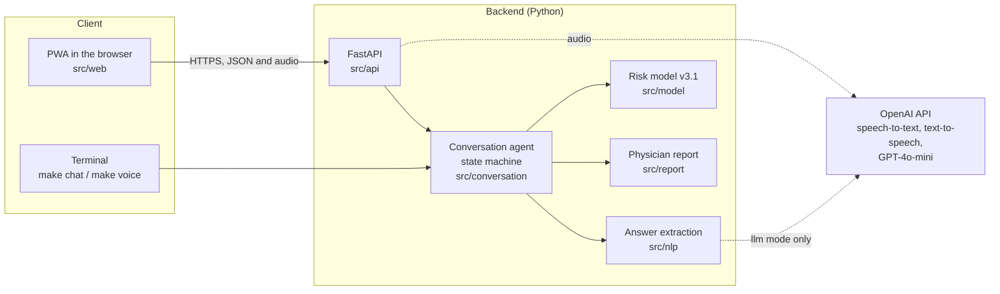
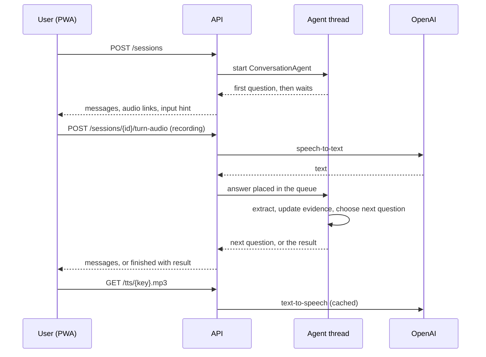
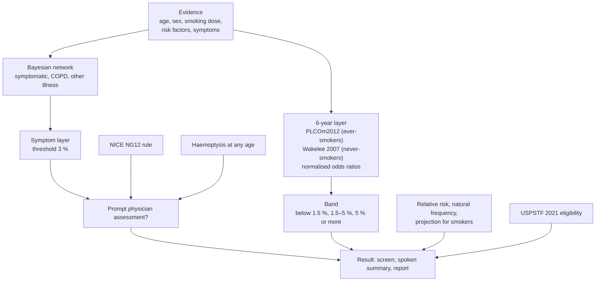

# Praevidio AI: system architecture

How the system is put together as of November 2026: the components, what happens in one conversation turn, where
the data lives and why the main design choices were made. The risk model itself is documented in
[`model_parameters.md`](model_parameters.md).

## 1. Overview

A user talks to the app in Turkish, by voice or by text, on a phone or a computer. A conversation agent asks about
age, smoking, symptoms and risk factors; a risk model turns the answers into a two-layer result; the user hears
and sees the result and can download a report for their physician.

The terminal and the web app share **one** agent. The API does not reimplement the interview; it runs the same
`ConversationAgent` object that `make chat` runs and passes messages in and out.

## 2. Components

| Layer | Code | What it does |
| --- | --- | --- |
| Web client | `src/web/` (`index.html`, `app.js`, `styles.css`, `sw.js`, `manifest.webmanifest`) | Installable progressive web app without a build step. Voice mode (record, send, play the reply) and text mode, quick-reply buttons including "what does this mean?", result screen with the 6-year risk, frequency bars and advice, report and transcript download. |
| API | `src/api/server.py`, `sessions.py` | FastAPI. One session per conversation; each session runs an agent in its own thread. Optional bearer token (`PRAEVIDIO_API_TOKEN`). Serves the web client at `/app`. |
| Conversation agent | `src/conversation/voice_agent.py` | Hand-written state machine: demographics and smoking, confirmation, symptoms, risk factors, result. Decides what to ask next and when to re-ask. |
| Side questions | `src/conversation/clarify.py` | Answers "what does pack-year mean?", "why do you ask?" or "can you repeat?" from a fixed glossary of 16 terms and 10 reasons, then repeats the pending question. |
| Transcripts | `src/conversation/transcript.py`, `replay.py`, `tools/replay_conversation.py` | Every conversation is written as plain `agent:` / `user:` lines and can be replayed against the current agent; recorded cases are regression tests. |
| Answer extraction | `src/nlp/symptom_extractor.py` | Turns a Turkish sentence into structured evidence. `keyword` mode is rule-based and offline; `llm` mode asks GPT-4o-mini for a JSON object and passes it through guards. Also maps the province to an air-pollution tier. |
| Speech | `src/stt/whisper_stt.py`, `Channel` in `voice_agent.py` | Speech-to-text with `gpt-4o-mini-transcribe` and a hint of medical terms; text-to-speech with OpenAI `tts-1`, voice "nova", cached per sentence. |
| Risk model | `src/model/hybrid_bayesian_network_v3.py`, `plcom2012.py`, `screening.py` | The two-layer result, the prompt-assessment rule and USPSTF screening eligibility. `load_engine("v2" \| "v3.0" \| "v3.1")` keeps earlier versions runnable. |
| Report | `src/report/report_generator.py`, `templates/report_template.html` | Physician report as PDF (Jinja2 and WeasyPrint): the three scores with their thresholds, the alert box with reasons, answers as given, ICD-10 codes of the reported symptoms. |
| ICD-10 retrieval | `src/rag/rag_pipeline.py`, `src/pipeline.py`, `data/knowledge_base/` | ChromaDB index of ICD-10 lung codes, used by the batch pipeline (`make pipeline`) to map free text to codes. The conversation agent does not need it. |

## 3. One conversation turn

The agent calls `say()` and `listen()` on a channel. In the terminal the channel prints and reads the keyboard or
the microphone. In the API the channel is a queue: `say()` appends to the outgoing messages and `listen()` blocks
the thread until the next request delivers an answer. The interview logic is therefore identical everywhere and
is tested once.

### Endpoints

| Endpoint | Purpose |
| --- | --- |
| `GET /health` | Liveness and loaded model versions |
| `POST /sessions` | Start a conversation; returns the first question |
| `POST /sessions/{id}/turn` | Send a typed or tapped answer |
| `POST /sessions/{id}/turn-audio` | Send a recorded answer |
| `GET /sessions/{id}` | Session state and, when finished, the result |
| `GET /sessions/{id}/report` | Physician report (PDF) |
| `GET /sessions/{id}/transcript.txt` | Transcript of the conversation |
| `POST /sessions/{id}/client-log` | Client-side diagnostics (for example microphone problems) added to the transcript |
| `GET /tts/{key}.mp3` | Spoken version of an agent message |
| `GET /app` | The web client |

## 4. The interview

1. **Demographics and smoking.** Age and sex, then smoking status with cigarettes per day and years. A bare "no"
   is followed by "did you smoke in the past?". Implausible doses (more than 60 cigarettes a day) are questioned.
2. **Confirmation.** The agent repeats what it understood in the user's own terms ("you have smoked 10 cigarettes
   a day for 10 years") and accepts corrections in one turn.
3. **Symptoms.** One open question; whatever the user mentions is recorded, and each symptom that was not
   mentioned is then asked individually. "I don't know" leaves a field unobserved, which the model treats
   differently from "no".
4. **Risk factors.** Family history, occupational exposure, COPD diagnosis, province.
5. **Result.** Spoken summary, result screen, report.

At any point the user may ask a side question; the agent answers it and returns to the pending question, at most
three times in a row.

## 5. From answers to a result

The app shows the 6-year risk with its band, the comparison with peers as a natural frequency, and a message
about the symptoms. The number of the symptom layer and the full score appear only in the physician report.
Details and sources: [`model_parameters.md`](model_parameters.md).

## 6. Data and privacy

| Data | Where | Kept in the repository |
| --- | --- | --- |
| NLST public subset (cleaned) | `data/processed/nlst_cleaned.csv` | yes (CC BY 4.0) |
| NHANES 2007–12 files | `data/raw/nhanes/` | no; downloaded with `make nhanes-download` |
| Provincial PM2.5 tiers, ICD-10 codes | `data/knowledge_base/` | yes |
| Conversation transcripts | `data/conversations/` | no; health data, git-ignored |
| Generated reports | `data/processed/reports/` | no |
| Audio | not stored; recordings are transcribed and discarded | – |
| API keys and access token | `.env` | no |

Speech and, in `llm` mode, the text of an answer are sent to OpenAI for processing. The risk model, the
conversation logic and the report run locally on the backend.

## 7. Design choices

**A state machine instead of an agent framework.** The interview is a clinical questionnaire with a fixed set of
fields. A hand-written state machine makes the order of questions, the re-asking and the corrections explicit and
testable, and the recorded conversations in `tests/conversations/` can be replayed deterministically. An agent
framework would add an abstraction without adding capability here.

**The language model translates; it does not decide.** GPT-4o-mini converts a sentence into fields and may answer
a side question under tight constraints. It never produces a risk, a diagnosis or advice. Guards discard a symptom
value when the user's sentence does not mention that symptom, and the age group is derived from the stated age and
never taken from the model.

**A Bayesian network instead of a classifier.** Every edge and number has a stated source, missing answers are
handled by marginalisation, and the behaviour can be checked against clinical references case by case
(`tests/model/`). No patient-level training data with symptoms was available, which rules out a learned model.

**Two layers instead of one score.** Screening and referral are different questions with different thresholds;
see [`symptom_layer.md`](symptom_layer.md).

**A progressive web app instead of a native app.** One codebase reaches iOS and Android through a link, with no
store review, and is enough for the usability study. The API is client-agnostic, so a native client can be added
later.

**Speech through a cascade.** Speech-to-text, then the agent, then text-to-speech. Each stage can be inspected in
the transcript, which matters more for a health application than the lower latency of an end-to-end voice model.

## 8. Running it

| Command | What it starts |
| --- | --- |
| `make api` | Backend and web client at `http://localhost:8000/app` |
| `make chat` / `make voice` | The same interview in the terminal, typed or spoken |
| `make model-test`, `make api-test`, `make conversation-test` | The three test suites |
| `make compare`, `make sensitivity`, `make v31-diff`, `make nhanes` | Regenerate the model reports in `docs/` |

To try the app on a phone, expose the local backend through a tunnel (for example
`cloudflared tunnel --url http://localhost:8000`) and open the printed address with `/app` appended.
