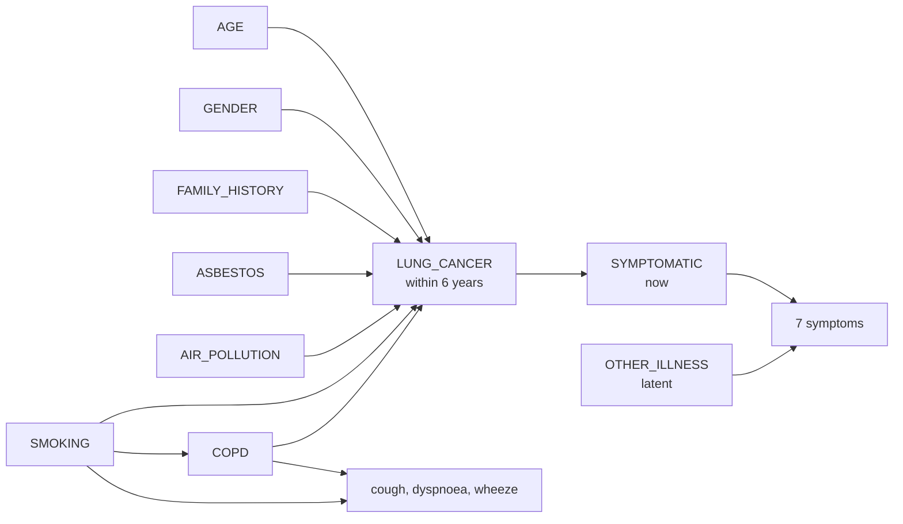

# Model parameters and their sources (risk model v3.1)

This is the reference for every number in the current risk model: where it comes from, what it does to the score
and how to change it. Code: `src/model/hybrid_bayesian_network_v3.py` and `src/model/plcom2012.py`. It replaces
the spring documents on the v2 model, which are archived in [`history/`](history/).

Why the model looks like this is told in [`model_v3_design.md`](model_v3_design.md) (v3.0),
[`model_v3_1_calibration_fix.md`](model_v3_1_calibration_fix.md) (v3.1) and [`symptom_layer.md`](symptom_layer.md).

## 1. Structure

The model answers two questions with two layers. Risk factors give the **6-year layer**: the probability of a lung
cancer diagnosis in the next six years. Symptoms are evidence about the present: they update that probability
through a Bayesian network and give the **symptom layer**.

The network has 17 nodes and 29 edges: 7 risk factors, `LUNG_CANCER`, the latent nodes `SYMPTOMATIC` and
`OTHER_ILLNESS`, and 7 symptoms (cough, dyspnoea, chest pain, wheeze, fatigue, haemoptysis, weight loss). Edges
into `LUNG_CANCER` are causes; edges out of it lead to evidence. Three respiratory symptoms also have smoking and
COPD as parents, and all seven have `OTHER_ILLNESS`.

## 2. The 6-year layer

### 2.1 Ever-smokers: PLCOm2012

For anyone who has smoked, the 6-year risk is the PLCOm2012 logistic model (Tammemägi et al., NEJM 2013;368:728).
It uses age and smoking dose as continuous variables, so it has no cohort boundary such as "55 to 74 years and 30
pack-years".

| Term | Coefficient | Input in Praevidio |
| --- | ---: | --- |
| Intercept | −4.532506 | |
| Age − 62 | +0.0778868 per year | exact age from the interview |
| Education − 4 | −0.0812744 | not asked; fixed at the centre (4) |
| BMI − 27 | −0.0274194 | not asked; fixed at the centre (27) |
| COPD | +0.3553063 | asked; if unknown, averaged over the prior (section 3.3) |
| Personal history of cancer | +0.4589971 | not asked; 0 |
| Family history of lung cancer | +0.587185 | asked; if unknown, averaged over a 10 % prior |
| Race or ethnicity | 0 (reference) | reference category |
| Current smoker | +0.2597431 | asked |
| (Cigarettes per day ÷ 10)⁻¹ − 0.4021541613 | −1.822606 | asked; derived from pack-years if needed, else 20 |
| Years smoked − 27 | +0.0317321 per year | asked; derived from pack-years if needed, else 27 |
| Years since quitting − 10 | −0.0308572 per year | asked; 0 for current smokers, 10 if unknown |

`risk = 1 / (1 + e^(−logit))`. Check: 62 years old, 20 cigarettes a day for 40 years, current smoker, nothing
else gives 2.34 %. The published screening threshold is 1.51 % over six years.

### 2.2 Never-smokers: Wakelee 2007

PLCOm2012 is not defined for never-smokers, and NLST enrolled none. Their base comes from Wakelee et al.
(J Clin Oncol 2007;25:472; six cohorts, ages 40 to 79): age-standardised incidence of 14.4 to 20.8 per 100,000
person-years in women and 4.8 to 13.7 in men.

| Parameter | Value | Source |
| --- | --- | --- |
| Incidence at the reference age, women | 17.6 per 100,000 person-years | midpoint of the Wakelee range |
| Incidence at the reference age, men | 9.3 per 100,000 person-years | midpoint of the Wakelee range |
| Reference age | 58 | assumption: centre of the cohorts |
| Increase with age | ×2.2 per decade | general age slope of lung cancer incidence |

`6-year risk = 1 − exp(−6 · rate)`. Examples: a woman of 58 gets 0.11 %, a man of 58 gets 0.06 %, a woman of 72
gets 0.32 %.

### 2.3 Other risk factors: normalised odds ratios

Occupational exposure and air pollution are not in PLCOm2012; for never-smokers family history and COPD are
needed as well. Each enters as an odds ratio from the literature, divided by its population average
`E[OR] = Σ prior · OR`. An average or unasked person therefore stays at the base rate, a person without the factor
falls slightly below it and a person with it rises above it.

| Factor | Literature OR | Prior | E[OR] | Multiplier used |
| --- | --- | --- | ---: | --- |
| Family history of lung cancer | 1.70 (ILCCO pooled RR 1.51, meta-analyses 1.88) | 10 % | 1.07 | no ×0.93, yes ×1.59 |
| Occupational exposure (asbestos and similar, self-reported) | 1.50 (ever exposed 1.24, marked exposure 2.04) | 8 % | 1.04 | no ×0.96, yes ×1.44 |
| Air pollution, by provincial PM2.5 | 1.00 / 1.15 / 1.30 (RR 1.16 per 10 µg/m³) | 10 / 70 / 20 % | 1.165 | low ×0.86, moderate ×0.99, high ×1.12 |
| COPD (never-smokers only; inside PLCOm2012 otherwise) | 1.43 (PLCOm2012, e^0.3553) | by smoking | 1.068 | no ×0.94, yes ×1.34 |

A factor that was not asked gets a multiplier of 1. The province named by the user is mapped to a PM2.5 tier in
`src/nlp/symptom_extractor.py`.

### 2.4 Bands of the 6-year layer

| Band | Range | Meaning |
| --- | --- | --- |
| Below the screening threshold | under 1.5 % | below the PLCOm2012 threshold of 1.51 % |
| Moderate | 1.5 to 5 % | at or above the threshold: a candidate for low-dose CT screening |
| High | 5 % or more | about 1.3 times the NLST base rate; the top risk fifth in Kovalchik 2013 |

Screening eligibility under USPSTF 2021 (age 50 to 80, at least 20 pack-years, current smoker or quit within
15 years) is computed separately in `src/model/screening.py` and shown beside the risk.

### 2.5 What NLST is still used for

The cancer node of the Bayesian network is learned from NLST (age group × sex × smoking, 53,452 participants). In
v3.1 it no longer sets the 6-year risk. It supplies the likelihood ratio of the symptom evidence (section 3.5), the
`nlst_6y_factors` field kept for comparison, and the whole 6-year layer when v3.0 is loaded.

## 3. The symptom side

### 3.1 Symptomatic now: q

Risk factors predict a diagnosis within six years; symptoms describe today. The latent node `SYMPTOMATIC` joins
the two: `P(symptomatic now | cancer within 6 years) = q = 0.35`, and 0 without cancer. A person can therefore
deny every symptom and keep most of the 6-year risk. q is an assumption, checked for consistency with the
predictive values of Hamilton 2005 and varied between 0.25 and 0.50 in [`sensitivity_v3.md`](sensitivity_v3.md);
the expert form asks for it (Part 2, question 1).

### 3.2 Symptom probabilities

Respiratory symptoms are noisy-OR nodes:

`P(symptom) = 1 − (1 − leak) · (1 − smoke)^smoker · (1 − copd)^COPD · (1 − cancer)^symptomatic`

| Symptom | leak | smoke | copd | cancer | P(symptom, symptomatic cancer, no other cause) |
| --- | ---: | ---: | ---: | ---: | ---: |
| Cough | 0.10 | 0.12 | 0.60 | 0.556 | 0.60 |
| Dyspnoea | 0.08 | 0.05 | 0.50 | 0.457 | 0.50 |
| Wheeze | 0.08 | 0.10 | 0.55 | 0.152 | 0.22 |

*leak* is the frequency in a never-smoker without COPD or cancer; *smoke* is the contribution of current smoking
apart from COPD; *copd* and *cancer* are the contributions of those causes. The other four symptoms have no
smoking or COPD parent:

| Symptom | P(symptom, no symptomatic cancer) | P(symptom, symptomatic cancer) |
| --- | ---: | ---: |
| Chest pain | 0.05 | 0.35 |
| Fatigue | 0.20 | 0.50 |
| Haemoptysis | 0.01 | 0.20 |
| Weight loss | 0.05 | 0.35 |

Sources. The probabilities in cancer come from the clinical literature on symptoms at presentation (Hamilton 2005,
Beckles 2003, Kvale 2006, Hopwood and Stephens 2000); their derivation is in
[`history/v2_symptom_cpt_derivation.md`](history/v2_symptom_cpt_derivation.md). The frequencies without cancer for
cough and wheeze were calibrated on NHANES 2007–12 ([`nhanes_symptom_baselines.md`](nhanes_symptom_baselines.md)):
wheeze 8 / 14 / 26 % in never, former and current smokers against 8.4 / 14.4 / 27.2 % in the survey.

### 3.3 COPD

`P(COPD | former smoker) = 0.12`, `P(COPD | current smoker) = 0.20` (self-reported COPD or emphysema in NLST is
about 15 to 18 %). When the user has a diagnosis, part of the respiratory symptoms is explained by it; when COPD
is unknown the model averages over this prior.

### 3.4 Other illness: the common cause

Without a common cause, symptoms in a person without cancer are independent of each other, and several symptoms
together multiply into an absurd likelihood ratio (seven symptoms gave ×3236 in v3.0). The latent node
`OTHER_ILLNESS` stands for infection, asthma, reflux, anxiety, musculoskeletal pain and the like.

| Parameter | Value | Meaning |
| --- | ---: | --- |
| π (`OTHER_PRIOR`) | 0.20 | probability that such an illness is present; never observed, only inferred |
| ρ (`OTHER_SHARE`) | 1.0 | share of each symptom's no-cancer frequency that is routed through the node |

For each symptom the node contributes `p_o = min(ρ · leak / π, p_cancer)` and the remaining leak becomes
`leak' = 1 − (1 − leak) / (1 − π · p_o)`, so the marginal frequency of every symptom in people without cancer is
unchanged and only the correlation between symptoms is added. The cap `p_o ≤ p_cancer` says that another illness
cannot produce a symptom more reliably than cancer does; without it, adding fatigue or wheeze lowered the risk.

| Symptom | p_o | leak' |
| --- | ---: | ---: |
| Cough | 0.50 | 0 |
| Dyspnoea | 0.40 | 0 |
| Chest pain | 0.25 | 0 |
| Weight loss | 0.25 | 0 |
| Haemoptysis | 0.05 | 0 |
| Fatigue | 0.375 (capped) | 0.135 |
| Wheeze | 0.152 (capped) | 0.051 |

Calibration: among 5,053 NHANES participants aged 40 or more without cancer, who never smoked and have no COPD
diagnosis, the odds ratio between chronic cough and wheeze is 4.1. The model gives 3.4 with these values and 1.0
without the node.

### 3.5 Combining symptoms with the 6-year layer

The network is evaluated twice, with and without the symptom answers. The ratio of the two posterior odds is the
likelihood ratio of the symptoms, and it is applied to the odds of the 6-year layer:

`odds(full score) = odds(6-year layer) × odds(network, all evidence) / odds(network, risk factors only)`

The full score mixes a six-year horizon with present symptoms, so it is reported as a number without a band.

### 3.6 What each answer does

Reference person: a man of 62 who smokes 20 cigarettes a day and has done so for 40 years, moderate air
pollution, no family history or occupational exposure, COPD denied; 6-year layer 2.23 %. One symptom is answered
and the others are not asked.

| Symptom | "Yes" multiplies the odds by | Full score | Symptom layer | "No" multiplies the odds by |
| --- | ---: | ---: | ---: | ---: |
| Haemoptysis | ×7.65 | 14.8 % | 13.6 % | ×0.93 |
| Chest pain | ×3.10 | 6.6 % | 5.2 % | ×0.89 |
| Weight loss | ×3.10 | 6.6 % | 5.2 % | ×0.89 |
| Dyspnoea | ×2.11 | 4.6 % | 3.2 % | ×0.84 |
| Cough | ×1.74 | 3.8 % | 2.4 % | ×0.81 |
| Fatigue | ×1.53 | 3.4 % | 1.9 % | ×0.87 |
| Wheeze | ×1.26 | 2.8 % | 1.3 % | ×0.95 |
| All seven | ×39.8 | 47.6 % | 46.8 % | ×0.67 (all denied: 1.50 %) |

With a COPD diagnosis the respiratory symptoms count for much less (cough ×1.09, dyspnoea ×1.12, wheeze ×1.03),
because COPD already explains them, while the 6-year layer itself rises to 3.15 %. The multipliers of the other
four symptoms do not depend on COPD.

Every combination of symptoms is tested against bounds derived from the positive predictive values in Hamilton et
al. 2005: at most ×11.3 for one symptom (×13.6 for haemoptysis), ×11.3 for a pair that includes cough, ×61.6 for
any combination without haemoptysis and ×113.6 overall (`tests/model/test_plausibility.py`).

## 4. Symptom layer and prompt assessment

`symptom layer = P(cancer | evidence) × P(symptomatic | cancer, evidence)`: the probability that the present
symptoms are caused by lung cancer. It is compared with a threshold of **3 %**, the positive predictive value at
which NICE NG12 recommends referral from primary care. The model value is an estimate and not a measured
predictive value, which is why the app shows the message and only the physician report shows the number.

Prompt physician assessment is advised when any one of these holds:

1. the NICE NG12 rule: age 40 or more with haemoptysis, or with two or more unexplained symptoms, or an
   ever-smoker with one;
2. a symptom layer of 3 % or more;
3. haemoptysis at any age.

## 5. Explaining a small percentage

`risk_context()` adds three statements that do not change any number: the **relative risk** against a never-smoker
of the same age and sex without risk factors; the same comparison as a **natural frequency** ("about 42 in 10,000
people like you; about 1.2 among such peers"); and, for current smokers, a **projection** of the 6-year risk at
age 50 (or five years ahead) if they continue and if they quit today. Tests: `tests/model/test_context.py`.

## 6. Changing a parameter

| Setting | Default | Effect |
| --- | --- | --- |
| `load_engine("v2" \| "v3.0" \| "v3.1")` | `"v3.1"` | spring model, October model, current model |
| `PRAEVIDIO_BASE_RISK` | `plco` | `nlst` restores the v3.0 base |
| `PRAEVIDIO_Q_SYMPTOMATIC` | 0.35 | q |
| `PRAEVIDIO_OTHER_CAUSE`, `PRAEVIDIO_OTHER_PRIOR`, `PRAEVIDIO_OTHER_SHARE` | on, 0.20, 1.0 | common-cause node |
| `PRAEVIDIO_NORMALIZE_ORS` | on | `0` applies the raw odds ratios |
| `PRAEVIDIO_SYMPTOM_REFERRAL_PPV` | 0.03 | threshold of the symptom layer |
| `PRAEVIDIO_BANDS` | `v3` | `v2` restores the 5 % and 15 % bands |

The same values can be passed to `load_engine` as keyword arguments, which is how
[`sensitivity_v3.md`](sensitivity_v3.md) is produced.

## 7. What is assumed and still to be confirmed

q, the COPD priors, the 3 % threshold and the bands are starting values to be reviewed in the expert session
(`tests/expert_validation/`). The age slope for never-smokers is a general figure and not an age-specific table.
PLCOm2012 was developed on people aged 55 to 74 and is extrapolated below 50. The association between symptoms is
still too weak in smokers (odds ratio 1.4 in the model, 3.7 in NHANES). The full list is in
[`model_v3_1_calibration_fix.md`](model_v3_1_calibration_fix.md), section 6.

## References

Tammemägi MC et al. Selection criteria for lung-cancer screening. N Engl J Med 2013;368:728–36. · Wakelee HA et al.
Lung cancer incidence in never smokers. J Clin Oncol 2007;25:472–8. · Hamilton W et al. What are the clinical
features of lung cancer before the diagnosis is made? Thorax 2005;60:1059–65. · NICE guideline NG12, Suspected
cancer: recognition and referral (2015, updated 2023). · Kovalchik SA et al. Targeting of low-dose CT screening
according to the risk of lung-cancer death. N Engl J Med 2013;369:245–54. · National Lung Screening Trial Research
Team. N Engl J Med 2011;365:395–409. · NHANES 2007–2012, National Center for Health Statistics. · Fenton N, Neil M.
Risk Assessment and Decision Analysis with Bayesian Networks, 2nd ed., CRC Press 2018.
